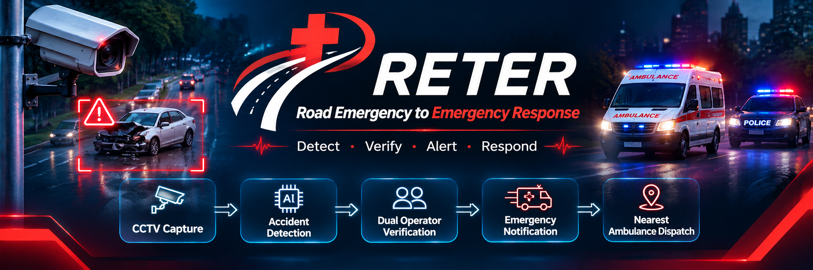

<div align="center">



# RETER
### Road Emergency to Emergency Response

**Detect · Verify · Alert · Respond**

An open-source concept exploring AI-assisted road-incident detection and coordinated emergency response using authorized CCTV infrastructure.


</div>

---

## The goal

Explore ways to reduce the time between a road incident being noticed and the appropriate emergency responders being notified—while keeping human operators in control.

## Proposed workflow

1. **CCTV capture** — An authorized, registered camera observes a road location.
2. **AI-assisted detection** — A detection system flags a possible incident for review.
3. **Human verification** — An operator reviews the alert and evidence.
4. **Second approval for serious incidents** — A second, different authorized operator independently reviews serious incidents.
5. **Emergency notification** — Only after the required approvals, the system may notify authorized police and ambulance control-room contacts.
6. **Response tracking** — A record tracks acknowledgement, assignment, response progress, and closure.

**Safety rule:** an AI prediction alone must never trigger emergency dispatch. A timeout, missing reviewer, or disagreement must not be treated as approval.

## Incident lifecycle

```text
POSSIBLE INCIDENT DETECTED
          |
          v
   PENDING OPERATOR 1
          |
          v
   OPERATOR 1 REVIEW
      /         \
  Reject      Approve
    |            |
    v            v
 Escalate   PENDING OPERATOR 2
                 |
                 v
          INDEPENDENT REVIEW
             /       \
         Reject     Approve
           |           |
           v           v
        Escalate   DUAL APPROVAL
                        |
                        v
               NOTIFICATIONS AUTHORIZED
                        |
                        v
                RESPONSE TRACKING
                        |
                        v
                      CLOSED
```

## Planned components

- Camera registry with fixed camera locations and road direction
- Incident detection and evidence review
- Operator dashboard and role-based access
- Independent two-operator approval for serious incidents
- Ambulance availability/location integration, where authorized
- Approved emergency notification integrations
- Incident response tracking and audit logs

## Project status

**Early-stage concept and documentation.** This repository currently contains a project landing page and design overview. It does not implement live CCTV monitoring, automatic accident detection, ambulance tracking, SMS notifications, or emergency dispatch.

## Roadmap

- [x] Project concept and initial documentation
- [x] GitHub landing page and visual identity
- [ ] Requirements and safety review with relevant stakeholders
- [ ] Camera registry and incident data model
- [ ] Secure operator login and permissions
- [ ] Incident review and dual-approval workflow
- [ ] Detection research and evaluation
- [ ] Authorized ambulance and notification integrations
- [ ] Controlled testing and validation

## Responsible use

- Use only CCTV feeds that the deploying organization is authorized to access.
- Follow applicable privacy, surveillance, and data-protection laws.
- Restrict access to video and incident records; protect evidence and define retention periods.
- Record operator decisions and important system actions in an audit log.
- Evaluate false positives and false negatives before any operational use.
- Integrate only with verified emergency-service contacts and approved systems.
- Never claim a message was received or a responder dispatched without confirmation.

RETER is not an emergency service. In an actual emergency, contact local emergency services directly.

## Contributing

Suggestions, documentation improvements, and responsible technical contributions are welcome. Please do not post private CCTV footage, personal information, credentials, API keys, or real emergency contact details in public issues or pull requests.

## License

This project is released under the MIT License. See [LICENSE](LICENSE).
